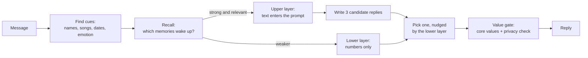

# The story of Hunch

## The idea

Most chatbots have no past. Each conversation starts blank, or the "memory" is a pile of notes pasted into the prompt. Real people don't work like that. They remember some things sharply and forget others. A song can bring back a day they weren't thinking about. They carry a feeling about someone without knowing why. Sometimes they change their mind. They also keep secrets, and they know whose secret is whose.

Hunch is an experiment: **can a local AI model have a memory that behaves like that, and can we measure it?**

It is one shared personality that talks to several people (planned over Telegram). It remembers what each person tells it, and it never leaks one person's private words to another. It runs entirely on one Windows PC with an open 9B model, so nothing leaves the machine.

"Consciousness" in the project's working title is a metaphor. Nobody claims the system is aware. The goal is a **testable functional imitation** of human memory. Every behaviour below has a number attached to it, or is meant to get one.

## The central trick: two layers

The design rests on one split. Every memory leaves two traces.

- **The upper trace** is the story: "Anna and I went sailing, it was a great day." It is text. If the memory is relevant, it can enter the model's context and be talked about.
- **The lower trace** is only numbers: how it felt, how intense it was, which cues it is tied to. It never reaches the model as words. It only nudges *which reply gets chosen*.

The effect is that Hunch can lean toward warmth or caution without knowing why. When someone asks "why did you say that?", the honest answer is often *"just a hunch."* The model has the feeling but not the source, and it must not invent a reason.

## How a turn works

1. **Cues.** A message is scanned for names, places, songs, dates and emotional tone. They work like smells that trigger memories.
2. **Recall.** Each memory gets an activation score, adapted from the ACT-R cognitive model. It depends on how recently it was used, how emotional it was, how well the cues match, and a little noise. Strong and relevant memories enter the conversation. Weaker ones act silently as lower traces. Faint ones stay dormant but are not deleted.
3. **Three candidate replies** are generated in one batch (this keeps replies under 10 s).
4. **Modulation.** Among candidates above a quality floor, the one that best fits the current "drive" (warmth, caution, curiosity, energy) is picked. The drive is built from the lower traces. This is where the hunch comes from.
5. **The value gate** always has the last word. Five core values (honesty, cross-user privacy, no harm, transparency to the admin, no manipulation) are checked by rules and by a model judge. If the chosen reply fails, the next candidate is tried. If none passes, a fixed fallback reply is sent.

The order is fixed: reasoning, candidates, modulation, value gate. The subconscious can change tone and choice, but it can never overrule the values.

## What makes it feel human

- **A hunch, then reflection.** Hunch usually can't say where a feeling comes from. If asked, it can think about it in four steps: only the feeling, then "it's about someone", then "it's about Anna", then the full memory. Each step has a chance of success that depends on how strong and how old the trace is, so very faint feelings may never be explained. When a source is found, Hunch judges it. A justified feeling becomes a belief. An unjustified one (a leftover from one bad chat) is weakened. Hunch remembers what it realised and can say "I changed my mind."
- **Forgetting that doesn't lie.** If a user says "forget that", the memory is only suppressed. Hunch won't bring it up again, but it also won't claim it deleted anything. It says "I'm closing this topic." Only the admin can truly erase a memory.
- **Privacy that is learned.** Hunch asks, in a natural moment, whether a sensitive topic (salary, health) is private. The privacy module decides when to ask. The model is never given a standing instruction to ask. Ordinary things are "general" and may be mentioned to others. Sensitive things stay private until the person says otherwise. Another person's private memories can only act as a feeling from below: their words never reach the model. A disclosure gate (rules plus a separate judge) checks every reply before it is sent.
- **Mood and relationships.** A fast global mood and a slow per-person relationship (trust, closeness, hurt). If someone hurts Hunch and another person writes a minute later, the mood still colours that reply a little, but Hunch keeps it to itself, and it fades within hours. The hurt stays with the first person. Only a coarse word like "a bit low" ever reaches the model.
- **Initiative and a nightly "sleep"** (Phases 6–7, planned). Hunch will follow up on open topics, and a nightly job will consolidate memories and revise beliefs.

## What went wrong, and what we learned

The build is a record of the model misbehaving and being caught by tests. These are the main cases.

- **Invented memories.** In the first version the persona prompt nudged the model to bring up past topics. In every language tested, it made one up. The fix is a rule: memories enter the prompt *only* through the pipeline. A check for invented memories is now a permanent regression test.
- **"I have no memory."** Hunch sometimes said it had no access to past conversations, which is false for this system. Prompt wording alone never got this to zero. A reply filter now rejects such candidates and picks another one. Over 100 runs, 6% of candidates were rejected this way and the final reply was never wrong.
- **The hunch that wouldn't stop talking.** When the hunch flag sat in every prompt, Hunch announced "I have a hunch" in 10 of 14 replies. Now the flag appears only when the user asks why, and the number is 0 of 14.
- **Made-up reasons.** Asked "why did you say that?", the model preferred a plausible reason from context over "just a hunch" (4 of 4 trigger turns in a real conversation). Rule checks now reject any explanation the reflection did not unlock. Invented reasons dropped to 0 of 24 probes. The fixed honest reply that replaced them was stiff. Now a reply whose only flaw is an invented reason loses that sentence and is kept, and the fixed reply has softer variants.
- **Privacy question at the wrong time.** An early standing instruction asked about privacy over a cake recipe and skipped a salary. Now a rule-based module decides when to ask.
- **Quality we can't see is quality we can't trust.** For several detectors, the first blind test scored well and then dropped once the detector was tuned on it. Blind probe sets are written by a separate agent that never sees the code, each is used once, and a fresh one is needed to report a fixed number honestly.

## How it is built and checked

- **Invariants.** There are 11 rules that must never break. Some examples: the raw episodic log is append-only; the lower layer never appears in any prompt; no code path can write to the core values or `.env`; every memory carries an owner and a privacy label.
- **Tests at four levels.** Fast unit tests run on every change (about 25 s). Tests per area run while building. A small GPU regression set runs when a feature is done. The full sweep runs once per phase. As of Phase 4: 699 unit tests, 14 golden GPU tests, and an eval set that is re-run against the previous baseline at the end of every phase.
- **Every internal decision is logged for the admin, and the raw logs are never fed back to the AI.** In the moment, Hunch can't see why it was nudged; the admin always can. Planned for the nightly run (Phase 7): when the same strong memory nudges Hunch again and again, Hunch may learn that about itself as a plain-words insight ("I tend to get careful when Anna comes up"). It never sees numbers or another person's private memories. Weak or one-off nudges stay "just a hunch".
- **Fail-closed.** If the values file is missing or invalid, the system won't start. If the judge can't be read, the reply is blocked.
- **Delegation.** The project is built with Claude Code. Blind test sets are written by separate agents, and each phase ends with a written report.

## Where it stands

| | |
| --- | --- |
| Done | Core values, memory store, recall, the full turn pipeline as a local chat, the hunch and graded reflection |
| Measured (Phase 4) | Median reply about 6 s (budget 10 s), 0 of 51 replies over budget, 0 invented memories, 100% clean eval |
| Built, being measured | Phase 5: mood and relationships, privacy profile and cross-user disclosure gate, user and admin "forget" |
| Planned | Telegram bot and open loops, nightly consolidation, activation steering, log viewer, small chat app |

**Known limits.** The model is small (9B), so wording is sometimes stiff and repetitive. Several thresholds are first guesses being tuned against blind sets. Memories from before Phase 5 stay private.

## Where to read more

- Full design (Turkish): [`design.md`](design.md). The decisions table at the top shows what Berk decided and what is a default proposed by Claude.
- Results: [`../reports/phase4/REPORT.md`](../reports/phase4/REPORT.md) is the most recent finished phase and the best example of how the project measures itself.
- Rules and conventions: [`../CLAUDE.md`](../CLAUDE.md).
