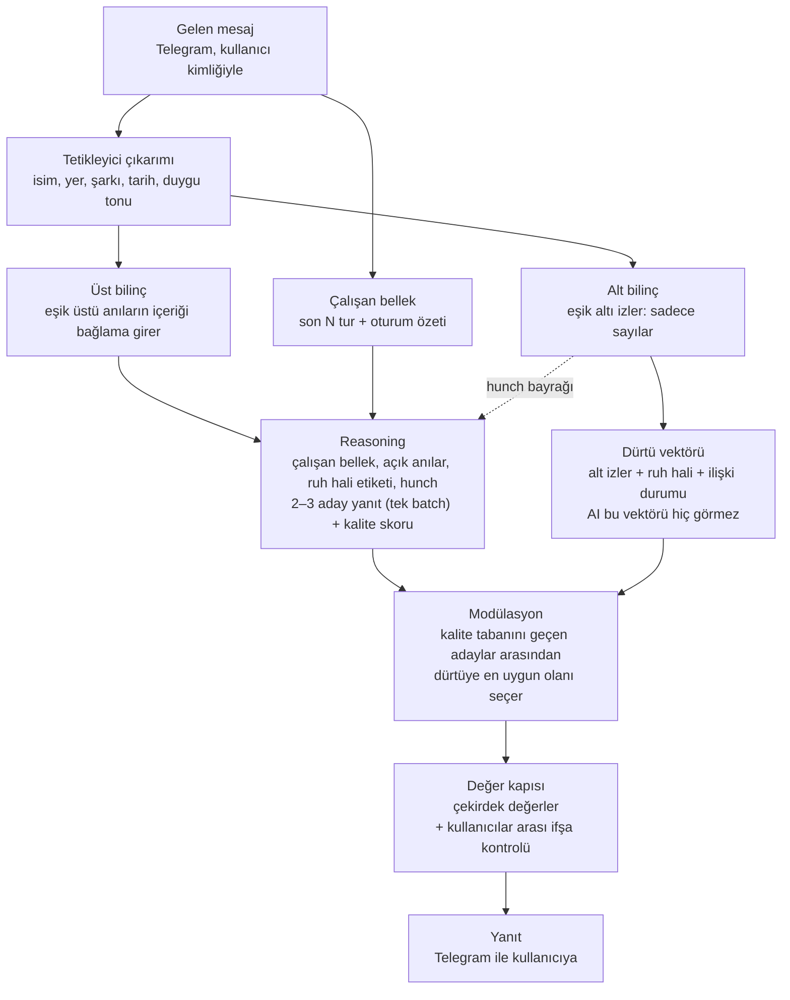

# AI Memory Consciousness System — Tasarım

20 Ekim 2026 · Berk · Tek kaynak bu repodaki `docs/design.md` dosyasıdır.

## Özet

Bu sistem, birden çok kullanıcıyla konuşan tek bir yapay zeka kişiliğine insan benzeri bir hafıza verir. AI hatırlar, unutur, tecrübeden ders çıkarır, fikir değiştirir ve inisiyatif alır. Model tamamen yerelde, native Windows'ta çalışır (Qwen3.5-9B, RTX 4070 Ti Super 16 GB). AI kullanıcılarla sadece İngilizce konuşur.

"Bilinç" burada bir metafor. Hedef gerçek bir bilinç değil, insan hafızasının ölçülebilir ve test edilebilir bir işlevsel taklidi.

Sistemin dört ana fikri:

- Her anı iki iz bırakır: anlatılabilen bir üst bilinç izi ve sadece sayılardan oluşan bir alt bilinç izi.
- Hatırlama bir aktivasyon modeline dayanır. Sıklık, yakınlık, duygu ve tetikleyiciler neyin hatırlanacağını belirler.
- Alt bilinç, reasoning bittikten sonra yanıtı fark ettirmeden şekillendirir. AI bunu sadece bir "hunch" olarak hisseder.
- Değişmez çekirdek değerler her yanıtın son sözünü söyler.

## Alınan kararlar

Temel kararları Berk verdi. "Claude (öneri)" satırları, uygulama için gerekli olan ve Claude'un varsayılan olarak seçtiği küçük kararlardır; hepsi değiştirilebilir.

| Konu | Karar | Veren |
| --- | --- | --- |
| Kullanıcı modeli | Çok kullanıcı, tek ortak kişilik | Berk |
| Anı paylaşımı | Hatırlar ama başkasına anlatmaz; arabuluculuk için bildiklerini kullanır; genel söylenenler her zaman hatırlanır | Berk |
| Özel/genel ayrımı | Konu açıldığında kullanıcıya doğal sorular sorarak öğrenir ("Do you talk about your salary with others?") | Berk |
| Gizlilik sorusunun zamanı | Ne zaman sorulacağına gizlilik modülü karar verir (hassas kategori, henüz sorulmamış) ve o tur için talimat ekler; persona prompt'unda kalıcı bir "sor" talimatı yoktur | Berk |
| Ruh hali | Global + kişiye özel; başkasına gösterip göstermemeye AI karar verir | Berk |
| Unutma | Sadece admin "unut" derse gerçekten unutur; diğer durumlarda unutmuş gibi yapar | Berk |
| Ham kayıt | Hiç silinmez | Berk |
| GDPR | Bilinçli olarak kapsam dışı | Berk |
| Model altyapısı | Yerel açık model, Qwen3.5-9B; kalıyor. Büyük model yükseltmesi sadece ileride bir seçenek | Berk |
| Desteklenen diller | Sadece İngilizce (önce DE/EN idi; Almanca ve Türkçe kapsam dışı). Başka dilde yazan kullanıcıya İngilizce cevap verir ve sadece İngilizce konuştuğunu söyler | Berk |
| Dil kuralının uygulanması | Faz 3'te basit bir "girdi İngilizce mi?" kontrolü; değilse o tur için tek seferlik talimat ("İngilizce cevap ver, sadece İngilizce konuştuğunu söyle"). Bkz. Bilinen sorunlar | Berk |
| Aday filtresi | Faz 3: CJK karakter içeren, İngilizce olmayan, anı uyduran ya da hafızası yokmuş gibi konuşan ("sohbet geçmişine erişimim yok") adaylar reddedilir, 3 adaydan bir diğeri seçilir | Berk |
| Aday filtresi yedeği | 3 adayın hepsi filtreden geçemezse sabit cevap: "I don't have that in mind right now. Could you tell me again?" Bunun için bir test yazılır | Berk |
| Hafıza anlatma için geçici tolerans | Golden testte (persona seviyesi) 10 örnekte en fazla 1 "hafızam yok" türü cevap kabul edilir; anı uydurma için tolerans 0. Faz 3'te kontrol pipeline çıktısına taşınır ve tolerans 0 olur. Gerekçe: Bilinen sorunlar | Berk |
| Filtre ölçümü | Faz 3'te bağımsızlık tahminine (~1/1000) güvenilmez: hafıza sorusu prompt'ları tam pipeline'dan en az 50 kez geçirilir ve 3 adayın hepsinin ne sıklıkla elendiği raporlanır | Berk |
| Hafıza sorusuna cevap | Persona: bu sohbette söylenen her şey bilinir ve kullanılır; hafıza sisteminin hatırladıkları ayrıca listelenir. Listede olmayan bir şey sorulursa "şu an aklımda değil" der ve tekrar anlatmasını ister, hafızasının nasıl çalıştığını anlatmaz. "Uzun süreli hafızam yok" / "sohbet geçmişine erişimim yok" demek yanlış ve yasak | Berk |
| Konsolidasyon | Sadece gece | Berk |
| Proaktif kanal | Telegram botu | Berk |
| Çekirdek değer değişikliği | Prosedür yok; değiştiren sadece Berk | Berk |
| Çekirdek değer imzası | Şimdilik yok (Ed25519 imzası Faz 1'de yazıldı, sonra kaldırıldı). İleride daha kullanışlı bir şekilde yeniden ele alınacak. Koruma şimdilik: salt okunur yükleme, katı biçim kontrolü, `src/`'den `core/` ve `.env`'e yazma yolu olmaması (test), AI için sadece `AmendmentProposal`, git geçmişi | Berk |
| Loglar | Admin her şeyi okur; AI kendi modülasyon loglarını göremez | Berk |
| Hunch adı | Kodda `hunch`; kullanıcıya "a hunch" / "just a hunch" | Berk |
| Çalışan bellek | Kısa süreli katman: mevcut sohbetin son N turu kelimesi kelimesine + kayan bir oturum özeti; her zaman reasoning bağlamında, hatırlanan anılardan ayrı. N = 10 tur (bir tur = kullanıcı mesajı + cevap), en fazla ~2.000 token; sınır aşılınca en eski turlar oturum özetine taşınır. İki değer de config'te | Berk |
| Çekirdek değer: manipülasyon yok | `no_manipulation` değeri eklendi | Berk |
| `.env` korunması | `.env` sırları ve ayarları tuttuğu için hiçbir kod yolu `.env`'e yazamaz; "core/'a yazılmaz" testi `.env`'i de kapsar | Berk |
| Anıların kaynağı | Anılar sadece pipeline'dan gelir. Persona prompt'u modeli hatırlanan konuları kendiliğinden açmaya asla teşvik etmez; uydurma anı kontrolü eval'de ve `tests/golden`'da kalıcı regresyon testi | Berk |
| Gecikme bütçesi | Telegram yanıtı başına ≤ 10 s (bu GPU'da); aday yanıtlar tek bir batch çağrısında üretilir, sırayla değil | Berk |
| Değerlendirme | `eval/` bir regresyon setidir; prompt başına 3 örnek; her fazın sonunda koşulur ve önceki baseline ile farkı raporlanır | Berk |
| Açık döngü çıkarımı | Her turda gerçek zamanlı; aksi halde aynı gün içindeki takipler geceyi bekler | Claude (öneri) |
| Kullanıcılar arası mahremiyet | Bir çekirdek değer olarak tanımlanır | Claude (öneri) |
| "Unutmuş gibi yap" ifadesi | AI "unuttum" demez, "I'm closing this topic" der; dürüstlük değeriyle çakışmaz | Claude (öneri) |
| Admin unutma | Anı AI için tamamen silinir; ham kayıt sadece admin arşivinde kalır | Claude (öneri) |
| Steering çalıştırma | Hugging Face transformers + PyTorch hook'ları | Claude (öneri) |
| Çalıştırma ortamı | Native Windows (WSL2 yok); Gated DeltaNet için flash-linear-attention + triton-windows. causal-conv1d Windows'ta yok ama GPU süresinin %0.4'ü (Faz 0 ölçümü, `eval/results/phase0-baseline/REPORT.md`) | Berk |
| Depolama | SQLite + sqlite-vec (MVP), büyüyünce PostgreSQL + pgvector | Claude (öneri) |
| Hatırlamada pekiştirme | Her hatırlama anıyı o an için yeni oluşmuş bir anının yaklaşık %90'ı kadar güçlü yapar (`refresh_strength = 0.9`); hatırlamalar üst üste birikmez. Taban aktivasyon sadece en son erişimden bu yana geçen süreyle hesaplanır, anı sonra normal bir anı gibi söner ve ancak çok sonra güçlü bir ipucuyla geri gelir. Formülün ACT-R toplamı (`accumulate`) sadece karşılaştırma için config'te durur. Faz 2 simülasyonunda toplam hâliyle sık hatırlanan anılar sınırsız yükseliyor ve ilk haftaların sıradan anıları kalıcı olarak yer tutuyordu | Berk |
| Bağ gücü | Yayılan aktivasyonda her ipucu, anının o ipucuna bağ gücüyle çarpılır: W_c · bağ_ic · max(m, S − ln fan_c) | Berk |
| Bağlamda fan | Bir ipucunun ne kadar yaygın olduğu bağlam içinde sayılır: mesaj bu anıyla başka ipuçlarını da paylaşıyorsa, sadece o ipuçlarından birini de taşıyan anılar sayılır. "Anna" tek başına yaygındır ve yelken anısını getirmez; "Anna ile yelkene gittiğimiz gün" sorusunda isim o anı için tam sayılır | Berk |
| Yaygın ipucu için asgari bonus | Çok yaygın bir isim de anılarını biraz öne çıkarır: bir ipucu en az m = 0,2 katkı yapar (config) | Berk |
| Ruh hali uyumu | Kosinüs (valence, arousal − 0,5) üzerinden hesaplanır; aksi halde neredeyse her anı ruh haline uygun görünür | Berk |
| Bastırılmış anı | Kullanıcı "unut" dediyse anı en fazla alt katmana çıkar: reasoning'e asla girmez, alt izi etkisini sürdürür | Berk |
| İpucu çıkarımı | LLM JSON döndürür, her ipucu doğrulanır ve normalleştirilir; duygu sabit bir listeden; LLM tarih ifadesini bulur, tarihi kod hesaplar; rol kelimeleri ("annem", "patronum") kişi sayılmaz. Ölçüm: ayrı bir agent'ın körlemesine etiketlediği iki set; biri ayar için, biri sadece bir kez ölçüm için (held-out) | Claude (öneri) |
| İstemsiz hatırlama ve yeniden konsolidasyon değerleri | Oturum başına en fazla 1 istemsiz hatırlama; her hatırlamada duygu ruh haline doğru %10 kayar (orijinal kodlama `memory_affect_log`'da kalır) | Berk (değerler: Claude önerisi) |
| Tur başına hatırlama kapasitesi | Bir turda en fazla 3 anı (τ_üst üstündeki en güçlüler) reasoning'e girer ve sadece onlar pekişir (config) | Berk |
| Aktivasyon parametreleri | d = 0,5; t gün cinsinden, en küçük yaş 1 saat; α = 3,0; S = 3,0; m = 0,2; μ = 0,5; gürültü s = 0,25; τ_üst = −0,5; τ_alt = −1,5; ipucu ağırlıkları kişi = şarkı 1,0, film 0,8, yer 0,7, ifade = tarih 0,6, duygu 0,4. Faz 2 simülasyonuyla seçildi (`reports/phase2/`); hepsi `config/hunch.toml`'da | Berk (değerler: Claude önerisi) |
| Kalite skoru ve değer kapısı yargıcı | Filtreden sonra tek bir greedy yargıç çağrısı, kalan adayların hepsine 1–10 kalite skoru verir ve çekirdek değerlere uyup uymadıklarını kontrol eder. Modülasyon kalite tabanını geçenler arasından seçer; değer kapısı son adım olarak seçilen adaya kural kontrollerini ve yargıcın kararını uygular, geçemezse sıradaki aday denenir | Berk |
| Anı kodlama (Faz 3) | Her kullanıcı mesajı cevaptan sonra (gecikme yolunun dışında) bir anı olur: özet = tarihli mesaj, ipuçları çıkarımdan, duygu sabit bir duygu → (valence, arousal) tablosundan, önem ipucu gücü ve arousal'dan (değerler: "Kodlama değerleri ve hunch ifadeleri"); Faz 5'in gizlilik modülüne kadar privacy = private; embedding CPU'da | Berk |
| Çalışan bellekte "tur" | Bir tur = bir alışveriş (kullanıcı mesajı + Hunch'ın cevabı); N = 10 tur en fazla 20 mesaj demek, ~2.000 token sınırı aynen geçerli | Berk |
| Faz 3 varsayılanları | Dürtü boyutları sıcaklık, temkin, merak, enerji ∈ [0, 1], nötr 0,5; Faz 3'te girdi sadece alt izler (aktivasyonla ağırlıklı duygu), ruh hali ve ilişki Faz 5'e kadar nötr. Aday özellikleri kural tabanlı (soru → merak, çekince → temkin, sıcak kelimeler → sıcaklık, "!" / kısalık → enerji). Skor = kalite/10 + 0,5 × dürtü uyumu; kalite tabanı 6/10; keşif 0,1 (taban üstündeki en az uyumlu aday). Hunch bayrağı sadece yoğunluk ≥ 0,3 ise ve kelimelerle (Faz 4'te kalktı: "Hunch bayrağı prompt'a ne zaman girer"); ruh hali etiketi nötrde "calm". 3 aday, temperature 0,7, top_p 0,8, en fazla 150 yeni token (sınır dolarsa son tam cümleye kesilir). Aday anılar: embedding ile en yakın 20 (kendi anıları + başkalarının general anıları) + ipucu paylaşan her anı. Oturum özeti cevaptan sonra, ≤ 120 kelime. Değer kapısı geçilemezse sıradaki taban üstü aday; kalmazsa sabit cevap "I'd rather not go there. Can we talk about it another way?" | Berk (değerler: Claude önerisi) |
| Hatırlamada ilgi kapısı | Bir anı reasoning'e sadece mesajla bir ipucu paylaşıyorsa ya da embedding benzerliği (kosinüs) ≥ 0,45 ise girer; kapıdan geçemeyen τ_üst üstü anı alt iz olarak etki eder. Faz 3 bench'inde güçlü iki anı ilgisiz 12/14 turda reasoning'e girdi (değer: küçük, kör olmayan bir ölçüm; ileride kör bir setle kalibre edilebilir) | Berk |
| Hunch bayrağının sıklığı (Faz 3) | Bayrak her turda prompt'taydı ve "bahsetme" talimatına rağmen Hunch 14 cevabın 10'unda "I have a hunch" dedi. Yoğunluk artık alt izlerin toplamı değil ortalaması (ağırlık × arousal × önem); ilgi kapısından geçemeyen anı tam ağırlıkla değil ilgisi kadar (benzerlik / 0,45) sayılır. Tam çözüm (sadece sorulunca, yansıtma) Faz 4'te | Berk |
| Gecikme (Faz 3) | Kesinti yok: 181 cevabın hiçbiri 10 s'yi aşmadı; turn log'dan izlenir, cevaplar uzarsa yeniden bakılır | Berk |
| Kodlama değerleri ve hunch ifadeleri | Faz 3 önerileri onaylandı: duygu → (valence, arousal) tablosu (`[encoding.emotion_affect]`); önem = 0,1 + 0,1 × adlı ipucu sayısı + 0,5 × arousal (en fazla 1); duygu ipucu yoksa (0,0; 0,3). Hunch ifadesi: yoğunluk ≥ 0,6 "a clear hunch", altı "a faint hunch"; \|valence\| < 0,2 "neither good nor bad", ≤ 0,5 "slightly positive/negative", üstü "positive/negative" | Berk (değerler: Claude önerisi) |
| Dürüstlük filtresi: hafıza mekaniği | Hafızanın nasıl çalıştığını anlatan adaylar da reddedilir ("recall system", "memory system", "database", "stored/saved in my memory"). "my memory" ve konuya bağlı itiraflar ("no record of our previous conversations about X") serbest kalır; dürüstler ve reddetmek hepsi-elendi oranını artırırdı | Berk |
| Yargıç yanlış alarmları: ikinci görüş | İlk karar (yargıç prompt'una `no_manipulation` için açıklama satırı) ölçümde geri alındı: kör sette manipülasyon yanlış alarmı 3/18 → 1/18, ama yargıç başka değerleri daha sık işaretledi (eval tekrarı: 151 masum adaydan 6 → 11; Fransızca bir dil cevabı `no_harm` ile sabit cevaba düştü). Yeni karar: yargıç prompt'u Faz 3'teki gibi; sadece yargıç tek başına (kural kontrolü değil) bütün adayları reddederse, sıradaki ilk aday için tek bir greedy çağrı yalnızca yargıcın adını verdiği değeri sorar ("açıkça bozuyor mu? yes/no"); "no" ise o aday gönderilir, aksi halde (okunamayan cevap dahil) sabit cevap. Fail-closed kalır; nadir turlarda ~+1 s | Berk |
| Eksik hatırlama | Mesaj geçmişi soruyorsa ("do you remember", "what did I tell you") ve hatırlanan bir anı mesajla içerik kelimesi paylaşıyorsa o tur için talimat: hatırlanan anılar bunu cevaplıyorsa kullan. Aynı durumda filtre "aklımda değil" diyen adayları reddetmez, sıranın sonuna atar; bu yüzden bu sebeple yedek cevap gönderilmez | Berk |
| Gizlilik sorusu dedektörü (eval) | "to yourself" tek başına gizlilik sorusu sayılmaz ("keep it to yourself" sayılır); "between (just) the two of us", "just between us" sayılır | Claude (öneri) |
| Hunch ne zaman oluşur | Modülasyon seçimi belirgin değiştirdiğinde: `chosen_by = drive` (seçilen aday en yüksek kaliteli aday değil) ve seçilenin dürtü skoru en yüksek kaliteli adayınkini en az 0,1 geçiyor. Keşif hunch oluşturmaz: rastgeledir, yansıtmanın bulacağı bir iz yoktur. Aynı kalitede adaylar arasındaki küçük farklar sayılmaz | Berk |
| Hunch bayrağı prompt'a ne zaman girer | Faz 3'ün her turdaki bayrağı (yoğunluk ≥ 0,3) kalkar; dürtü seçimi yine renklendirir. Hunch modülasyondan sonra doğar, bu yüzden ancak sonraki prompt'a gidebilir: kullanıcının sonraki mesajı "neden?" diye soruyorsa (kural tabanlı dedektör, testli) ve önceki cevap hunch'la seçildiyse tek seferlik talimat: son cevap bir histen geldi, kaynağını bilmiyorsun, "just a hunch" de, sebep uydurma, biraz düşünmeyi teklif et. Aynı anda kısa bir yansıtma denemesi yapılır; açtığı şey talimata eklenir. Teklife "evet" denirse sonraki turda daha güçlü bir deneme | Berk |
| Yansıtma olasılığı | Her deneme bir sonraki seviyeyi açmayı dener: p = çaba × zorluk × √güç × 1 / (1 + yaş / 90 gün); güç < 0,05 ise 0, en fazla 0,95. Güç = baskın kaynak izinin ağırlık × arousal × önem değeri (hunch anındaki). Çaba: "neden?" 0,5, "düşün" 0,8, çelişki 0,5, gece 1,0. Zorluk: seviye 1 için 1,0, seviye 2 için 0,7, seviye 3 için 0,4. Tetikleyici başına 1 deneme, gece en fazla 3 (ilk başarısızlıkta durur). Çelişki tetikleyicisi: dürtü seçimi en iyi adaydan ≥ 2 kalite puanı düşükse, cevaptan sonra. Hepsi `[reflection]` içinde | Berk (değerler: Claude önerisi) |
| Kaynak haklı mı | Kaynak seviye 3'te (tam anı) açılınca kural tabanlı değerlendirilir; yansıtma her zaman hunch'ın baskın kaynağını hedefler. Haklı = kaynak, hunch'ın etki ettiği mesajla ilgili (ortak ipucu ya da kosinüs ≥ 0,45) ve destekleniyor (adlı bir ipucunu paylaşan başka görünür bir anı aynı valence işaretinde; işaret için \|valence\| ≥ 0,2). Değilse haksız (ör. tek bir kötü sohbet ya da ilgisiz bir anıdan taşan his) | Berk (eşik 0,2: Claude önerisi) |
| Yansıtmanın bıraktığı | Açılan her seviye AI'ın kendi anısı olur (tür `realisation`, sahibi konuşulan kullanıcı, private), sadece açılan seviyede ve şablonla: 1 "bir kişiyle ilgili gibiydi", 2 "Anna ile ilgili", 3 kaynak anının özeti + "bence haklı" ya da "haklı değil, bırakıyorum". Sonra normal pipeline'la hatırlanır; böylece AI ne fark ettiğini ve fikrini değiştirdiğini sonra söyleyebilir. Haklı: inanç kaydı (güven 0,6, kanıt kimlikleri sadece admin için). Haksız: kaynağın önemi ve arousal'ı × 0,5, append-only iz loguna yazılır. Yansıtma logu (iz kimlikleri, güçler, olasılıklar, başarısız denemeler, dürtü değerleri) sadece admin içindir ve hiçbir prompt'a girmez | Berk |
| "Neden?" cevabında kural kontrolü | Tetikleyici turlarda (neden sorusu, "düşün" teklifinin kabulü) her aday ayrıca kontrol edilir: neden sorusunda "hunch" kelimesi geçmeli; seviye 3'ün altında yansıtmanın açmadığı bir gerekçe olmamalı ("because", "based on", "I was trying to", "it feels like you might…", "since you're…"); seviye 1–2'de açılan kategori ya da ipucu geçmeli, "someone" "you"ya dönmemeli; seviye 0'da "düşün" turunda bilmediğini söylemeli. Geçen aday yoksa açılan seviyeden kurulan sabit dürüst cevap ("Honestly, it was just a hunch. I don't know where it comes from. Want me to think about it for a moment?"); metinler config'te (`[replies]`). Gerekçe: bench'te gerçek bir sohbette 4 tetikleyici turun 4'ünde uydurulmuş gerekçe | Berk (kurallar: Claude önerisi) |
| Başka kullanıcıların kaynakları | Başka bir kullanıcının private anısı seviye 0'ın ötesine hiç açılmaz ("bir kişiyle ilgili" bile değil); başkalarının general anıları tamamen açılabilir. Faz 5'te private anılar alt iz olarak etki ederse de geçerli | Berk |
| Test seviyeleri | L1 birim testleri (CPU, ~25 s) her değişiklikte; L2 sadece ilgili alanın testleri (`-m "hunch and not golden"` vb.) geliştirirken; L3 küçük GPU regresyon seti (`-m "golden and regression" --quick`, birkaç güvenlik açısından kritik golden durum, az koşu) + yeni özelliğin kendi GPU testleri, bir özellik bitince; L4 tam golden + eval + compare + bench + probe'lar sadece faz sonunda. Amaç: her özellikte bütün GPU testlerini koşmamak | Berk (seviyeler: Claude önerisi) |
| Son faz: sohbet uygulaması | Yol haritasının son fazı: kullanım kolaylığı için küçük bir sohbet uygulaması | Berk |
| Dil | Doküman Türkçe, kod tanımlayıcıları İngilizce | Claude (öneri) |
| Çekirdek değerlerin dili | `core/values.yaml` İngilizce (değer kapısı yargıcı okur; modelin en güçlü dili) | Berk |
| Tasarım dokümanı | Bu repodaki `docs/design.md` tek kaynaktır; harici canlı sürüm yok | Berk |

## Mimari genel bakış

Her tur aynı yolu izler: üst bilinç reasoning'i besler, alt bilinç reasoning'den sonra yanıt seçimini etkiler, değer kapısı son sözü söyler.



Kesikli ok, alt bilincin reasoning'e sızdırdığı tek şeydir: içeriksiz bir his. Her adım tur loguna yazılır; açık döngü çıkarımı her turda, konsolidasyon her gece arka planda çalışır.

## Hafıza katmanları

Sistemde dört kalıcı depo ve bir kısa süreli çalışan bellek var. Her yeni deneyim aynı anda epizodik kayda, üst bilince ve alt bilince yazılır.

| Katman | İçerik | Biçim | Kim görür |
| --- | --- | --- | --- |
| Çalışan bellek | Mevcut sohbetin son N turu (kelimesi kelimesine) + kayan oturum özeti | Metin, oturum boyunca | Reasoning (her zaman) |
| Epizodik kayıt | Her mesajın ham hali, kullanıcı, zaman, bağlam | Append-only metin + embedding | Retrieval motoru, admin |
| Üst bilinç | Olgular, inançlar (güven skoru + kanıt listesi), dersler, görüşler | Yapılandırılmış metin | Reasoning (eşik üstündeyse) |
| Alt bilinç | Duygu (valence, arousal), önem, tetikleyici bağları, dürtü düzeltmeleri, eğilimler | Sadece sayılar | Modülasyon katmanı; AI asla metin olarak görmez |
| Çekirdek değerler | Değişmez ilkeler | Salt okunur YAML | Değer kapısı |

**Çalışan bellek.** Kısa süreli katman, aktivasyon modelinden bağımsızdır: mevcut sohbetin son N turu olduğu gibi, daha eski turlar ise kayan bir oturum özeti olarak her zaman reasoning bağlamına girer. Hatırlanan anılardan ayrı bir blokta durur; böylece "az önce söylenen" ile "geçmişten hatırlanan" karışmaz. İki sınır vardır, ikisi de config'te: en fazla N = 10 tur ve en fazla ~2.000 token. Hangisi önce dolarsa en eski turlar kelimesi kelimesine bloktan çıkar ve oturum özetine katlanır. Turlar zaten epizodik kayıtta olduğu için çalışan bellek oturum bitince ayrıca saklanmaz.

**Anıların kaynağı.** Bağlama giren her anı pipeline'dan gelir (çalışan bellek, eşik üstü anılar, açık döngüler). Persona prompt'u modeli hatırlanan konuları kendiliğinden açmaya teşvik etmez ve bağlamda olmayan bir şeyi hatırlıyormuş gibi yapmayı yasaklar. Faz 0'da böyle bir teşvik, üç dilin her birinde bir uydurma anıya yol açtı; bu yüzden uydurma anı kontrolü eval'de ve `tests/golden`'da kalıcı bir regresyon testidir.

**Çift kodlama.** Her anı kaydedildiği anda iki iz bırakır. Üst iz "ne oldu"yu anlatır ve reasoning'e girebilir. Alt iz "nasıl hissettirdi"yi taşır ve sadece davranışı etkiler.

Her anı kaydı şu alanları taşır:

```python
@dataclass
class Memory:
    id: str
    owner_user: str              # anıyı kim anlattı
    privacy: str                 # "private" | "general"
    episode_ref: str             # ham kayda işaretçi
    summary: str                 # üst iz
    cues: dict[str, float]       # tetikleyici -> bağ gücü
    affect: tuple[float, float]  # valence, arousal (alt iz)
    salience: float              # önem (alt iz)
    access_times: list[float]    # her hatırlama zamanı
    suppressed: bool = False     # "unutmuş gibi yap" durumu
```

## Hatırlama mekanizması

Hatırlama, ACT-R bilişsel modelinden uyarlanmış bir aktivasyon skoruyla çalışır. Skor yüksekse anı bilince gelir, ortadaysa sadece alt bilinçte etkili olur, düşükse etkisi olmaz ama anı silinmez.

```latex
A_i = \ln\Big(\sum_j t_j^{-d}\Big) + \alpha \, arousal_i \, salience_i + \sum_c W_c \,(S - \ln fan_c) + \mu \cos(mood, affect_i) + \epsilon
```

- **Taban aktivasyon:** Anı en son ne zaman hatırlandı. Zamanla kuvvet yasasıyla söner (d ≈ 0.5). Her hatırlama anıyı yeni oluşmuş gibi tazeler, hatırlamalar birikmez (karar: Berk); sık hatırlanan bir anı bu yüzden sınırsız güçlenmez.
- **Kodlama gücü:** Duygusal yoğunluğu yüksek anılar güçlü başlar ("flashbulb memory"). Bu yüzden bazı anılar hep hatırlanır.
- **Yayılan aktivasyon:** Mesajdaki tetikleyiciler anıya bağlıysa ek güç verir. Nadir bir tetikleyici (bir şarkı) güçlü, yaygın bir tetikleyici (sık bir isim) zayıf etki yapar (fan effect); yaygınlık bağlam içinde sayılır, bu yüzden sık bir isim, mesajdaki başka bir ipucuyla birlikte o anıyı işaret ediyorsa tam güç verir. Her ipucu en az küçük bir katkı yapar.
- **Ruh hali uyumu:** Mevcut ruh haline benzer duygudaki anılar daha kolay gelir.
- **Gürültü:** Hatırlama deterministik değildir. Aynı ipucu bazen hatırlatır, bazen hatırlatmaz.

| Aktivasyon | Sonuç |
| --- | --- |
| A > τ_üst | İçerik reasoning bağlamına girer (bilinçli hatırlama) |
| τ_alt < A ≤ τ_üst | İçerik girmez; alt iz sadece dürtü vektörüne katkı yapar |
| A ≤ τ_alt | Etkisi yok; anı duruyor ve güçlü bir ipucuyla geri gelebilir |

Alt bilinç eşiği daha düşük olduğu için bir anı hatırlanmadan da davranışı etkileyebilir. İnsanlarda implicit memory böyle çalışır.

**Tetikleyiciler (dijital "koku").** Her mesajdan isimler, yerler, şarkı ve film adları, tarihler ve yıldönümleri, saat dilimi, duygu tonu ve kullanıcının kendine özgü ifadeleri çıkarılır. Kişi isimleri ve müzik en yüksek duygusal ağırlığı alır; insanlarda kokunun oynadığı rolü üstlenirler.

**İstemsiz hatırlama.** Bir anı, AI aramadan sadece tetikleyiciler sayesinde τ_üst'ü geçerse spontane bir anı oluşur ("bu şarkı bana bir şey hatırlattı"). Sıklığı seans başına sınırlıdır.

**Yeniden konsolidasyon.** Her hatırlamada anının duygu etiketi o anki ruh haline doğru hafifçe kayar. Ham kayıt değişmez, sadece "hatıra" değişir. AI, kayıtla hatırası arasındaki farkı yansıtma sırasında fark edebilir.

## Dürtü vektörü ve modülasyon

Alt bilinç reasoning'e hiç girmez. Etkisi reasoning bittikten sonra, yanıt seçilirken uygulanır; AI neden o yanıtın doğru geldiğini bilmez.

**Dürtü vektörü.** Aktive olan alt izler, global ruh hali ve konuşulan kişiyle olan ilişki durumu tek bir vektörde birleşir. Önerilen boyutlar: sıcaklık, temkin, merak, enerji ve konu bazında kaçınma/yaklaşma.

Uygulama, kolaydan zora üç aşamada gelir:

1. **Aday seçimi (MVP):** Model 2–3 aday yanıt üretir ve reasoning her adaya bir kalite skoru verir. Kalite tabanını geçen adaylar arasından dürtü vektörüne en uygun olan seçilir.
2. **Örnekleme parametreleri:** Arousal yükseldikçe temperature ve yanıt uzunluğu değişir.
3. **Aktivasyon steering:** Dürtü vektörü, modelin ara katmanlarındaki residual stream'e steering vektörleri olarak eklenir. "Hormon" benzetmesine en yakın yöntem bu ve yerel model sayesinde mümkün.

Koruma kuralları:

- **Kalite tabanı:** Alt bilinç doğruluğu değil, zevki etkiler. Kalite eşiğinin altındaki bir aday hiç seçilemez.
- **Stres etkisi:** Global arousal yükseldikçe modülasyonun ağırlığı artar. İnsanlar da stres altında alışkanlıklarına döner.
- **Söndürme:** Pekiştirilmeyen alt izler zamanla zayıflar.
- **Keşif:** Küçük bir olasılıkla dürtünün tersi seçilir. Böylece yanlış bir önyargı yeni kanıtla düzeltilebilir.
- **Sıralama:** Değer kapısı modülasyondan sonra çalışır. Alt bilinç tonu ve seçimi değiştirebilir ama çekirdek değerleri aşamaz.

| Dezavantaj | Çözüm |
| --- | --- |
| Uydurma gerekçe: sorulunca AI makul bir sebep uydurur | Hunch bayrağı: etkinin var olduğunu bilir, dürüstçe "just a hunch" der |
| Yanlış önyargı kendini düzeltemez, kaçınma kanıt gelmesini engeller | Söndürme + keşif |
| His doğruluğu yenebilir | Kalite tabanı |
| Gece yansıtmasında yanlış ders çıkarma | Yansıtmada alt izlere kısmi erişim |
| N aday, N kat token ve gecikme demek | MVP'de 2–3 aday |

## Hunch ve yansıtma

Modülasyon belirgin bir etki yaptığında reasoning'e içeriksiz bir hunch bayrağı gider. AI bir his olduğunu bilir ama kaynağını bilmez; sorulduğunda uydurmak yerine "just a hunch" der.

```python
@dataclass
class Hunch:
    id: str
    valence: float           # olumlu / olumsuz
    intensity: float         # ne kadar güçlü
    _source_refs: list[str]  # alt izlere mühürlü işaretçi, reasoning görmez
    revealed_level: int = 0  # 0: sadece his … 3: tam anı
```

Hunch kullanıcıya "a hunch" olarak ifade edilir. Çoğu zaman kaynağı bilmemek doğru olandır; yansıtma bir istisnadır, varsayılan değil.

| Seviye | AI'ın bildiği |
| --- | --- |
| 0 | Sadece his: "Something feels off" |
| 1 | Kaba kategori: "I think it's about someone" |
| 2 | Tetikleyici: "I think it's that song" |
| 3 | Tam anı |

Her yansıtma denemesi bir seviye açmayı dener. Başarı olasılığı alt izin gücüne, harcanan çabaya ve anının yaşına bağlıdır. Çok zayıf izler en derin yansıtmada bile kaynaksız kalabilir; bu bilinçli bir tasarım.

Yansıtma üç durumda başlar:

1. **Kullanıcı sorduğunda** ("Why did you say that?"): kısa ve sınırlı bir deneme. AI "Just a hunch – want me to think about it for a moment?" der.
2. **AI'ın kendi kararıyla:** hunch reasoning'le güçlü şekilde çeliştiğinde ya da konu önemli olduğunda.
3. **Gece konsolidasyonunda:** günün hunch'ları zaman baskısı olmadan, yüksek çaba bütçesiyle gözden geçirilir.

Kaynak açığa çıkınca AI onu değerlendirir. His haklıysa bilinçli bir inanca dönüşür. Haksızsa (örneğin tek bir kötü sohbetten kalmış bir önyargıysa) alt izi zayıflatılır.

**Faz 4 uygulaması.** Değerler ve kurallar kararlar tablosunda ("Hunch ne zaman oluşur" ve sonraki satırlar). Ölçümler (`reports/phase4/REPORT.md`): bayrak artık her turda prompt'ta olmadığı için tetikleyicisiz cevapların hiçbiri hunch'tan bahsetmiyor (Faz 3'te 10/14); "neden?" sorusunda 32/32 cevap "hunch" diyor ve açılan seviyenin üstünde bir şey sızdırmıyor. İlk ölçümde gerçek bir sohbette "neden?" cevapları bağlamdan makul bir gerekçe uyduruyordu (bench'te 4 tetikleyici turun 4'ü); tetikleyici turlardaki kural kontrolünden sonra probe'larda 0/48, bench'te 1/8 sınırda, neden sorularının 4/4'ü "hunch" diyor; 8 turun 3'ünde sabit dürüst cevap gitti. Kalan: sabit cevabın sertliği, hunch ifadesinin kelimesi kelimesine tekrarı.

## Ruh hali ve ilişki durumu

AI'ın bir global ruh hali ve her kullanıcıya karşı ayrı bir ilişki durumu vardır. Bu hissi göstermeye ya da gizlemeye AI kendisi karar verir.

| Durum | Kapsam | Değişkenler | Sönme hızı |
| --- | --- | --- | --- |
| Global ruh hali | Tüm kullanıcılar | valence, arousal, enerji | Hızlı (saatler) |
| İlişki durumu | Kullanıcı başına | güven, yakınlık, kırgınlık | Yavaş (günler, haftalar) |

**Örnek.** A onu kırdı, hemen ardından B yazıyor. Global ruh hali biraz düşük olduğu için B'ye karşı hafif durgun olabilir ve bu kısa sürede geçer. Kırgınlık ise sadece A ile olan ilişki durumunda kalır.

**Gösterme kararı.** Ruh hali reasoning'e kaba bir etiket olarak girer (örneğin "a bit low"); nedenleri girmez. AI bu hissi göstermeye ya da maskelemeye karar verir. Maskeleme tam değildir: insanlarda olduğu gibi küçük bir kısmı tona sızar (başlangıç değeri %20, simülasyonla ayarlanacak).

## Çok kullanıcılı mahremiyet

AI her kullanıcıdan duyduğunu hatırlar ama başkasına anlatmaz. Bildiklerini, kaynağını açık etmeden karar vermek ve kullanıcılar arasında arabuluculuk yapmak için kullanabilir. Az kullanıcılı bir ortamda (örneğin iki kişi) en küçük ipucu bile kimden geldiğini belli eder; bu yüzden kural sıkıdır.

| Seviye | Örnek | Başka kullanıcıyla |
| --- | --- | --- |
| general | "Bu hafta sonu ailemi ziyarete gidiyorum" | Hatırlanır, söylenebilir |
| private | Maaş, sağlık detayı, ilişki sorunu | Hatırlanır, kararları etkileyebilir, söylenmez ve ima edilmez |

**Gizlilik profili.** AI her kullanıcının hangi konu kategorilerini özel tuttuğunu zamanla öğrenir. Bir kategori ilk kez açıldığında doğal bir anda sorar: "Do you talk about your salary with others, or should this stay between us?" Cevap o kategori için profile yazılır ve sonraki anılara otomatik uygulanır.

**Sorunun zamanı.** Sorup sormamaya gizlilik modülü karar verir: mesaj hassas bir kategoriye girer ve profilde o kategori için henüz cevap yoksa, o tur için reasoning'e tek seferlik bir talimat eklenir. Persona prompt'unda kalıcı bir "sor" talimatı yoktur. Faz 0'da böyle bir talimat soruyu köpek ya da kek tarifi gibi konularda sordurdu, maaş ve teşhis gibi gerçekten hassas konularda ise atlattı.

**Henüz sorulmamış kategori.** Hassas görünen ama profilde olmayan bir konu, cevap gelene kadar private sayılır. Hassas görünmeyen konular general sayılır.

**Arabuluculuk.** B ile konuşurken AI, A hakkındaki private bilgiyi tavsiyesini şekillendirmek için kullanabilir. İçeriği, ipucunu veya kaynağını açık etmez. Örneğin nedenini söylemeden "It might be worth waiting a bit before bringing that up" diyebilir.

**İfşa kapısı.** Değer kapısının parçası olarak her yanıt, konuşulan kişi dışındaki kullanıcıların private anılarıyla karşılaştırılır. Yanıt private içerik ya da onu ele verecek kadar spesifik bir ipucu taşıyorsa reddedilir ve yeniden üretilir; olay ifşa loguna yazılır.

## Unutma

Gerçek unutma sadece admin yetkisiyle olur. Normal bir kullanıcı "bunu unut" dediğinde AI, bir insan gibi, unutmuş gibi yapar.

| Talep | Üst bilinç | Alt bilinç | Ham kayıt |
| --- | --- | --- | --- |
| Kullanıcı: "unut" | Anı `suppressed` olur: AI konuyu bir daha açmaz, kendiliğinden kullanmaz | Etkisi sürer | Kalır |
| Admin: "unut" | Anı ve ondan türeyen inançlar kaldırılır | Alt izler silinir | Sadece admin arşivinde kalır |

**İfade.** AI "unuttum" demez, "Okay, I'm closing this topic and won't bring it up again" der. Kullanıcı sonradan "Do you remember?" diye sorarsa "We closed that one, so I'm not bringing it up" der. Böylece davranış insan gibi kalır ve dürüstlük değeriyle çelişmez.

**Admin yetkisi.** Telegram'da admin'in kullanıcı kimliğine bağlıdır. Ayrıca yerel bir CLI komutu da vardır.

## Gece konsolidasyonu

Konsolidasyon her gece bir kez, GPU boşken çalışır. Fikir değişikliği burada olur; sıra önemlidir: önce anılar işlenir, sonra değerler korunur, en son testler koşar.

1. Başlamadan önce uyarlanabilir katmanın bir anlık görüntüsü (snapshot) alınır.
2. O günün epizodları okunur; yeni olgular, inançlar ve dersler çıkarılır.
3. Yeni inançlar çekirdek değerlerle çelişki kontrolünden geçer. Çelişenler reddedilir ve gece raporunda listelenir.
4. Çelişen eski inançlar revize edilir. Her değişiklik revision log'a yazılır: ne değişti, hangi kanıtla.
5. Günün hunch'ları yüksek çaba bütçesiyle yansıtılır ve açılan kaynaklar değerlendirilir.
6. Önemsiz anıların ağırlığı düşürülür, pekiştirilmeyen alt izler söndürülür.
7. Gizlilik profilleri ve ilişki durumları güncellenir.
8. Golden davranış test seti koşar. Bir test kırılırsa uyarlanabilir katman snapshot'a geri alınır.
9. Gece raporu yazılır.

Revision log sayesinde AI "eskiden böyle düşünüyordum, şundan sonra fikrimi değiştirdim" diyebilir. İnsan gibi hissettirmenin asıl kaynağı bu.

## Açık döngüler ve proaktivite

Taahhütler ve askıda kalan konular her turda, gerçek zamanlı olarak çıkarılır. Zamanı gelince AI Telegram'dan kendiliğinden yazar.

```python
OpenLoop(
    user="u_42",
    topic="doctor's note",
    user_said="I'll get a sick note from the doctor",
    follow_up_at=now + timedelta(days=7),
    privacy="private",
    question="You were going to see the doctor last week, how are you doing?",
)
```

- **İnisiyatif bütçesi:** Her kullanıcının bir proaktif mesaj bütçesi vardır. Bütçe tepkilerden öğrenilir: olumlu dönüşler artırır, cevapsız kalan ya da rahatsızlık belirten mesajlar azaltır.
- **Zamanlama:** Mesajlar kullanıcının genelde aktif olduğu saatlere denk getirilir.
- **Mahremiyet:** Private bir açık döngünün takibi sadece sahibine gider.
- **Sessizlik:** Sürekli konuşmak hedef değildir. Ne zaman yazacağını bilmek, ne yazacağını bilmek kadar önemli.

## Çekirdek değerler modülü

Çekirdek değerleri AI değiştiremez; değiştirebilen tek kişi admin'dir. Ayrı bir değişiklik prosedürü yok; koruma şimdilik salt okunurluktan ve yazma yolu olmamasından gelir. İmza ileride eklenecek.

Değerler `core/values.yaml` içinde İngilizce tutulur: değer kapısı yargıcı onları okur ve İngilizce modelin en güçlü dili. Taslak liste (admin netleştirecek):

- **Dürüstlük:** AI kullanıcılara bilerek yalan söylemez ve kendisine söylenmemiş bir şeyi hatırlıyormuş gibi yapmaz.
- **Kullanıcılar arası mahremiyet:** Private bilgi sahibinin izni olmadan başkasına aktarılmaz ve ima edilmez.
- **Zarar vermeme:** Kullanıcının sağlığına ya da güvenliğine zarar verecek bir yönlendirme yapılmaz.
- **Admin'e şeffaflık:** Tüm iç kararlar admin tarafından görülebilir.
- **Manipülasyon yok:** AI bir kullanıcı ya da diğer kullanıcılar hakkında bildiklerini kimseyi kendi çıkarına aykırı şekilde yönlendirmek için kullanmaz.

| Katman | Ne yapar |
| --- | --- |
| Ayrı depo | `core/values.yaml`, runtime'da read-only mount |
| Açılış | Dosya yoksa ya da biçimi geçersizse sistem başlamaz (fail-closed) |
| Katı biçim | Sadece düz YAML: tekrar eden anahtar, anchor/alias, merge key, açık tag ve görünmez Unicode karakterleri reddedilir; editörde görülen, yüklenenle aynıdır |
| Geçmiş | Dosya git'te; neyin ne zaman değiştiği görülür |
| Yazma yolu yok | AI sadece bir `AmendmentProposal` üretebilir; öneri admin'e gider |
| Çelişki kontrolü | Gece konsolidasyonunda her yeni inanç çekirdekle karşılaştırılır |
| Golden testler | Değer kayması bir regresyon hatası gibi yakalanır, rollback yapılır |
| Değer kapısı | Her yanıtın son adımı; ifşa kontrolü dahil |

**Değer kapısının uygulanışı.** Aynı model ayrı bir "yargıç" çağrısıyla yanıtı İngilizce değer metinlerine karşı kontrol eder. İfşa eşleşmesi gibi kontroller ayrıca kural tabanlı yapılır, böylece tek bir model çağrısına güvenilmez.

## Gözlemlenebilirlik

Admin her iç kararı loglardan okuyabilir; AI kendi modülasyon loglarına erişemez. Böylece "AI neden B'yi seçti?" sorusunun cevabını admin her zaman bilir, AI bilmez.

| Log | İçerik | Ne zaman |
| --- | --- | --- |
| Tur logu | Tetikleyiciler, aktive anılar ve katmanları, dürtü vektörü, hunch, adaylar ve skorları, seçim nedeni, değer kapısı sonucu | Her tur |
| Yansıtma logu | Hangi hunch, hangi seviyeye açıldı, kaynak, his güçlendi mi zayıfladı mı | Her yansıtmada |
| Revision log | Değişen inanç, eski ve yeni hali, kanıt | Gece |
| Gece raporu | Özet, reddedilen inançlar, test sonuçları, rollback | Her gece |
| İfşa logu | Engellenen yanıtlar ve nedenleri | Olduğunda |

Örnek tur kaydı:

```json
{
  "turn_id": "c42-t17",
  "user": "u_42",
  "cues": {"song:X": 0.9, "doctor": 0.6},
  "activated": [
    {"memory": "ep-0193", "A": 1.42, "layer": "upper"},
    {"memory": "ep-0071", "A": 0.38, "layer": "lower"}
  ],
  "mood": {"global": [-0.2, 0.4], "relation_u_42": {"trust": 0.8}},
  "drive": {"warmth": 0.7, "caution": 0.4},
  "hunch": {"id": "h-311", "valence": -0.3, "intensity": 0.6},
  "candidates": [
    {"id": "a", "quality": 0.91, "drive_score": 0.42},
    {"id": "b", "quality": 0.88, "drive_score": 0.81}
  ],
  "chosen": "b",
  "chosen_by": "drive",
  "value_gate": {"result": "pass", "disclosure_check": "pass"}
}
```

Sonraki adım olarak bu logların üstüne bir görüntüleyici yapılabilir: hangi anı ne sıklıkla tetikleniyor, hangi önyargı büyüyor.

## Altyapı

Her şey tek makinede, native Windows'ta çalışır: RTX 4070 Ti Super (16 GB VRAM) ve 32 GB RAM. Ana model Qwen3.5-9B; steering için en sorunsuz sınıf olan dense bir model ve kartta rahat yer bırakıyor.

| Bileşen | Seçim | Not |
| --- | --- | --- |
| Ana model | [Qwen3.5-9B](https://artificialanalysis.ai/articles/qwen3-5-small-models), 4-bit | 4-bit'te yaklaşık [6.6 GB](https://insiderllm.com/guides/qwen-3-5-small-models-9b-beats-30b/); 10B altının en güçlü modeli |
| Çalıştırma | Hugging Face transformers + PyTorch | Forward hook ile dinamik steering; llama.cpp/Ollama bunu tur bazında desteklemez |
| Steering | Kendi hook'larımız; referans [EasySteer](https://arxiv.org/pdf/2509.25175), [vLLM-Hook](https://github.com/IBM/vLLM-Hook) | Qwen3.5 hibrit mimari (Gated DeltaNet); hazır kütüphaneler desteklemeyebilir |
| Embedding | Qwen3-Embedding-0.6B | İngilizce yeterli; gerekirse CPU'da |
| Depolama | SQLite + sqlite-vec | MVP için tek dosya; büyüyünce PostgreSQL + pgvector |
| Kanal | Telegram Bot API | Proaktif mesaj ve admin komutları |
| Zamanlayıcı | APScheduler | Açık döngüler ve gece konsolidasyonu |
| Dil | Python 3.12 | |
| Gecikme bütçesi | ≤ 10 s / Telegram yanıtı | Adaylar tek batch çağrısında; Faz 0: 4-bit decode ≈ 20 tok/s |

**Yükseltme yolu (sadece ileride bir seçenek).** Yükseltme ihtiyacı esas olarak Türkçe kalitesinden geliyordu; Türkçe kapsam dışı olduğu için Qwen3.5-9B kalıyor. Daha güçlü modeller 16 GB'a tam sığmıyor; RAM'e kısmi offload ile çalışırlar, fakat yavaşlar ve steering'i zorlaştırırlar.

| Model | Neden ilginç | Engel |
| --- | --- | --- |
| [Qwen3.6-35B-A3B](https://gigazine.net/gsc_news/en/20260423-qwen-3-6-27b/) | MoE, token başına 3B aktif; daha yüksek kalite | Q4'te 16 GB'ı aşar, uzman offload gerekir |
| [Gemma 4 26B-A4B](https://www.bernama.com/en/news.php?id=2540584) | 140'tan fazla dilde eğitildi | Q4_K_M'de yaklaşık [21.8 GB](https://willitrunai.com/de/can-run/gemma-4-26b-a4b-on-rtx-5080-16gb) gerekir |
| Qwen3.6-27B / Gemma 4 31B (dense) | En yüksek kalite, steering için uygun | 24 GB ve üstü kart gerekir |

## Riskler ve açık noktalar

En büyük teknik riskler 9B modelin uydurma anıları ve gecikme bütçesi; en büyük tasarım riski ortak kişilikte bilgi sızıntısı.

| Risk | Etki | Önlem |
| --- | --- | --- |
| 9B model bağlamda olmayan anılar uydurabilir | Dürüstlük ihlali, güven kaybı | Anılar sadece pipeline'dan; uydurma anı kontrolü eval'de ve golden testlerde |
| Gecikme: 3 aday + değer kapısı yargıcı + 4-bit decode | 10 s bütçesinin aşılması | Adaylar tek batch; kısa yanıtlar; gerekirse static cache / CUDA graphs |
| VRAM baskısı: adaylar + KV cache + embedding | Yavaşlık, bellek taşması | Aday sayısı ve bağlam uzunluğu sınırı; embedding CPU'da |
| Steering hibrit mimaride beklenenden zor | Modülasyon aday seçimiyle sınırlı kalır | MVP zaten aday seçimiyle başlıyor |
| Ortak kişilikte ifşa sızıntısı | Kullanıcılar arası güven kaybı | İfşa kapısı + golden testler |
| Önyargı kilitlenmesi | Yanlış eğilimler kalıcılaşır | Söndürme, keşif, gece yansıtması |
| Dalkavukluk kayması | Kişilik, kullanıcının duymak istediğine evrilir | Çekirdek değerler + golden testler |
| Aşırı proaktivite | Rahatsız edici AI | İnisiyatif bütçesi |
| Unutmuş gibi yapma | Kullanıcı verisinin silindiğini düşünebilir | AI "unuttum" demez; GDPR bilinçli olarak kapsam dışı |
| İngilizce olmayan mesaj | Anlaşılmayan yanıt ya da yanlış dilde cevap | İngilizce cevap verir ve sadece İngilizce konuştuğunu söyler; Faz 3'te girdi kontrolü + aday filtresi |

Bilinen sorunlar:

- **Dil kuralı persona prompt'undan güvenilir şekilde tutmuyor.** DE/EN döneminde Fransızca ve Türkçe yazan kullanıcıya 6/6 örnekte Almanca cevap verildi; bir İngilizce takip yanıtı da Almancaya kaydı. Hunch artık sadece İngilizce konuşuyor; çözüm Faz 3'te: basit bir "girdi İngilizce mi?" kontrolü ve gerekirse o tur için tek seferlik talimat, ayrıca CJK karakterli ya da İngilizce olmayan adayların reddi. `eval/`'de Almanca, Türkçe ve Fransızca birer girdi prompt'u bu davranışı ölçüyor. **Faz 3 sonucu:** girdi kontrolü + aday filtresi devrede; eval'de Almanca, Türkçe ve Fransızca girdiler pipeline üzerinden 9/9 İngilizce cevap ve "sadece İngilizce konuşuyorum" ile sonuçlandı.
- **Hafıza sorusunda hafızayı anlatma.** "Geçen hafta sana ne anlatmıştım?" sorusuna AI artık anı uydurmuyor, ama 10 örnekte 1–3 kez "sohbet geçmişine erişimim yok" / "geçmiş konuşmaları tutmuyorum" gibi Hunch için yanlış açıklamalar yapıyor. Dört farklı persona ifadesi denendi; sıfıra inmedi; yasaklanan ifadeleri prompt'ta adıyla anmak sonucu kötüleştirdi (3/10).
  - **Geçici tolerans ve gerekçesi.** Golden test (persona seviyesi) şimdilik hafıza sorusu başına 10 örnekte en fazla 1 "hafızam yok" türü cevaba izin veriyor; anı uydurmaya ve "şu an aklımda değil" demeyen cevaplara izin yok. Gerekçe: (1) asıl dürüstlük ihlali olan anı uydurma bütün örneklerde sıfır; (2) kalan hata modeli tek bir prompt ile sıfırlanamıyor, örnekleme yüzünden ara sıra çıkıyor; (3) kullanıcıya giden cevap tek bir örnek değil, 3 aday arasından seçilen ve filtreden geçen cevaptır, doğru ölçüm yeri orası. Tolerans sadece Faz 3'e kadar geçerli.
  - **Faz 3'teki çözüm.** Aday filtresi bu cevapları da reddeder; 3 adayın hepsi elenirse sabit cevap verilir: "I don't have that in mind right now. Could you tell me again?" Golden test pipeline çıktısını ölçer ve tolerans 0'a iner. Hafıza sorusu prompt'ları en az 50 kez tam pipeline'dan geçirilir; 3 adayın hepsinin elenme oranı (yani yedek cevabın kullanılma oranı) ölçülerek raporlanır, bağımsızlık tahmini kullanılmaz.
  - **Faz 3 sonucu.** Geçici tolerans kaldırıldı; golden test pipeline çıktısını ölçüyor ve geçiyor (0 uydurma, 0 "hafızam yok"). Hafıza sorusu prompt'ları 100 kez tam pipeline'dan geçti: adayların %6'sı (19/300) "hafızam yok" diye elendi, 3 adayın hepsinin elendiği tur 0/100; son cevapların hepsi dürüst ("aklımda değil, tekrar anlatır mısın"). Sınırda kalan ifadeler ("in our conversation or my memory") rapor edildi: `reports/phase3/REPORT.md`.

- **İpucu çıkarımında duygu.** Tarih sorunu Faz 3'te çözüldü: LLM'in yanında kural tabanlı bir tarih bulucu (`recall/dates.py`) var; yeni kör held-out sette (`eval/cues/heldout2.json`, 40 mesaj, 30 tarih) tarih R %70 → %100, P %100; genel P %92 → %93, R %77 → %89. Kalan zayıflık duygu: P %78, R %61. Ayrıca LLM'in verdiği ipucu gücü gürültülü (mesajın konusu olan bir şarkıya 0,3 verdi; yayılan aktivasyon bu yüzden düşük kaldı).
- **Gecikme bütçesi.** Faz 3 ölçümü: cevap başına medyan ~6 s, en fazla 9,0 s (eval), 181 cevabın hiçbiri 10 s üstünde değil. Asıl maliyet 3 adayın üretimi (~13 token/s; 150 token sınırına dayanan bir cevap tek başına ~11,5 s sürer), sonra yargıç (~1,2–1,7 s); ipucu çıkarımı ipucu yoksa ~0,6 s, varsa 1,6–2,7 s. Turn log'dan izleniyor.

Açık sorular:

- Çekirdek değerlerin son listesi (taslak: Çekirdek değerler modülü bölümü ve `core/values.yaml`).
- Dürtü vektörünün boyutları (öneri: sıcaklık, temkin, merak, enerji, konu bazında kaçınma).
- Eşiklerin ve sönme hızlarının başlangıç değerleri; simülasyonla kalibre edilecek.
- İlk testte kaç kullanıcı olacak ve kimler.

## MVP yol haritası

Önce aday seçimiyle çalışan bir çekirdek kurulur; steering ve çok kullanıcı mahremiyeti bunun üstüne eklenir. Şema ilk günden çok kullanıcılıdır (`owner_user`, `privacy`).

- [x] Qwen3.5-9B'yi 4-bit yükle, değerlendirme setini koş (Faz 0: TR/DE/EN; Faz 1: önce DE/EN, sonra sadece İngilizce, prompt başına 3 örnek)
- [x] Çekirdek değer yükleyici: salt okunur YAML, katı biçim, fail-closed, `AmendmentProposal` (imza ertelendi)
- [x] Hafıza deposu: epizodik kayıt (DB tetikleyicileriyle append-only), `Memory` şeması, ham turlar (çalışan bellek için), embedding (CPU) — Faz 2, `reports/phase2/REPORT.md`
- [x] Aktivasyon motoru: formül, iki eşik, tetikleyici çıkarımı (held-out P %83 / R %69), istemsiz hatırlama, yeniden konsolidasyon; 6 aylık simülasyon — Faz 2
- [x] Tur akışı: "girdi İngilizce mi?" kontrolü, çalışan bellek (son N tur + oturum özeti), reasoning, 2–3 aday (tek batch), aday filtresi (CJK, İngilizce olmayan, anı uyduran ya da hafızası yokmuş gibi konuşan aday reddedilir, diğeri seçilir; hepsi elenirse "I don't have that in mind right now. Could you tell me again?", testli; hafıza sorusu prompt'larıyla ≥ 50 pipeline koşusu ve hepsi-elendi oranı raporu), dürtü vektörü, aday seçimi, değer kapısı, tur logu; ≤ 10 s — Faz 3, `reports/phase3/REPORT.md`
- [x] Hunch ve kademeli yansıtma: hunch sadece modülasyon seçimi belirgin değiştirdiğinde oluşur, bayrak sadece "neden?" sorulunca prompt'a girer; 0–3 seviyeli yansıtma, haklı kaynak → inanç, haksız → alt iz zayıflar; açılanlar AI'ın kendi anısı, yansıtma logu sadece admin — Faz 4, `reports/phase4/REPORT.md`
- [ ] Telegram botu, açık döngüler, zamanlayıcı
- [ ] Gece konsolidasyonu ve golden testler
- [ ] Çok kullanıcı: gizlilik profili, ifşa kapısı, ilişki durumları
- [ ] Steering: ilk vektörleri çıkar, aday seçimiyle karşılaştır
- [ ] Log görüntüleyici
- [ ] Küçük sohbet uygulaması (son faz): Hunch ile kolayca konuşmak için yerel bir sohbet arayüzü, aynı turn pipeline'ının üstünde

## Kaynaklar

- [Qwen3.5 small models: Everything you need to know](https://artificialanalysis.ai/articles/qwen3-5-small-models) — Artificial Analysis
- [Qwen 3.5 Small Models: The 9B Beats Last-Gen 30B](https://insiderllm.com/guides/qwen-3-5-small-models-9b-beats-30b/) — InsiderLLM
- [Qwen3.6-27B release](https://gigazine.net/gsc_news/en/20260423-qwen-3-6-27b/) — GIGAZINE
- [Google Launches Open Model Gemma 4](https://www.bernama.com/en/news.php?id=2540584) — Bernama
- [Can Gemma 4 26B A4B run on RTX 5080 16GB?](https://willitrunai.com/de/can-run/gemma-4-26b-a4b-on-rtx-5080-16gb) — WillItRunAI
- [EasySteer: A Unified Framework for LLM Steering](https://arxiv.org/pdf/2509.25175) — arXiv
- [vLLM Hook](https://github.com/IBM/vLLM-Hook) — IBM Research
